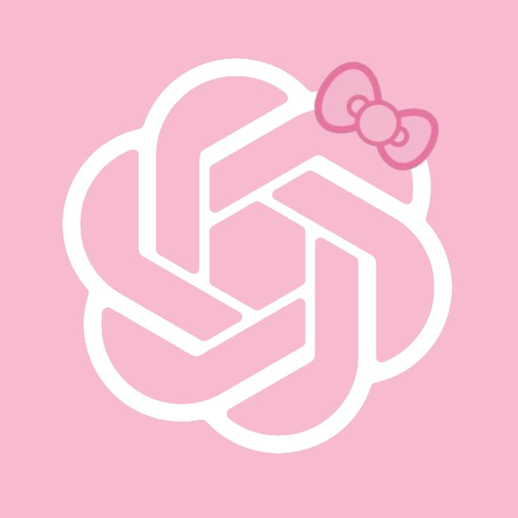

<div align="center">
  

  <h1>🌙 NHIỆM VỤ MẶT TRĂNG</h1>
  <p><strong>Web game tâm lý học tương tác thời gian thực cho lớp học</strong></p>

  <p>
    <a href="https://moon-mission.vercel.app">🚀 Live Demo</a> •
    <a href="#quick-start">⚡ Quick Start</a> •
    <a href="#kiến-trúc">🏗 Kiến trúc</a> •
    <a href="#deploy">☁️ Deploy</a>
  </p>

  
  
  
  
  
</div>

---

## Giới thiệu

**Nhiệm Vụ Mặt Trăng** số hóa bài tập sinh tồn kinh điển *"Problems in Space"* của NASA, được các nhà tâm lý học sử dụng hơn 50 năm để chứng minh rằng **quyết định nhóm hiệu quả hơn quyết định cá nhân**.

Thay vì phát tờ giấy và chấm tay, giảng viên chỉ cần chiếu mã QR — **150+ học viên tham gia bằng điện thoại, làm bài 10 phút, hệ thống tự chấm điểm và xếp hạng tức thì.**

```
Giảng viên chiếu QR  →  Học viên quét → Sắp xếp 15 vật phẩm → Nộp bài
        ↓                                                           ↓
  Admin Dashboard  ←────────────── Supabase (realtime) ────────────┘
  (Xếp hạng toàn lớp, export CSV)
```

---

## Tính năng

### 👨‍🏫 Phía Giảng viên (Host)
- Tạo phòng với mã 6 ký tự tùy chỉnh (VD: `NASA01`)
- Mã QR tự tạo gắn với phòng — chiếu thẳng lên màn hình
- Bảng điều khiển thời gian thực: số người vào, số bài đã nộp
- Điều khiển: **Bắt đầu** / **Khóa phòng** / **Công bố kết quả** / **Reset**
- Xuất file CSV toàn bộ kết quả

### 📱 Phía Học viên
- Tham gia bằng QR hoặc link — không cần đăng ký tài khoản
- Kéo thả (Drag & Drop) sắp xếp 15 vật phẩm, hỗ trợ nút ⬆️⬇️ trên mobile
- Đồng hồ đếm ngược đồng bộ với server
- Autosave liên tục — không mất dữ liệu khi tải lại trang
- Tự nộp bài khi hết giờ

### 📊 Hệ thống chấm điểm
Dựa trên **Error Score (E)** — tổng sai lệch tuyệt đối giữa thứ hạng người chơi và chuyên gia NASA:

```
E = Σ |rank_player[i] − rank_expert[i]|   (i = 1..15)

Điểm Sống Sót = ROUND(100 × (112 − E) / 112)
```

| Điểm | Trạng thái |
|------|-----------|
| 70–100 | 🟢 SỐNG |
| 40–69 | 🟡 SỐNG HẤP HỐI |
| 0–39 | 🔴 HẸO |

---

## Quick Start

### Yêu cầu
- Node.js ≥ 18
- npm ≥ 9
- Tài khoản [Supabase](https://supabase.com) (free tier đủ dùng)

### 1. Clone & cài đặt

```bash
git clone https://github.com/Dang-Xuan-Phat/moon-mission.git
cd moon-mission
npm install
```

### 2. Cấu hình environment

```bash
cp .env.example .env.local
```

Chỉnh sửa `.env.local`:

```env
# Supabase — lấy từ Project Settings > API
NEXT_PUBLIC_SUPABASE_URL=https://xxxxxx.supabase.co
NEXT_PUBLIC_SUPABASE_ANON_KEY=eyJhbGci...
SUPABASE_SERVICE_ROLE_KEY=eyJhbGci...

# Mật khẩu đăng nhập trang admin
ADMIN_PASSWORD=your_secure_password

# URL app (đổi khi deploy)
NEXT_PUBLIC_APP_URL=http://localhost:3000
NEXT_PUBLIC_DEMO_MODE=true
```

### 3. Tạo database schema

Vào **Supabase Dashboard → SQL Editor**, chạy file:

```bash
supabase/migrations/20261011_initial_schema.sql
```

Nếu gặp lỗi quyền, chạy thêm:

```bash
supabase/fix_permissions.sql
```

### 4. Chạy development server

```bash
npm run dev
```

Mở [http://localhost:3000](http://localhost:3000)

---

## Cấu trúc thư mục

```
moon-mission/
├── public/
│   └── assets/
│       ├── team-chatgpt-logo.png   # Logo team
│       ├── QRCODE.png              # QR tĩnh tùy chỉnh
│       ├── cat-song.png            # Ảnh kết quả SỐNG
│       ├── cat-haphoi.png          # Ảnh kết quả SỐNG HẤP HỐI
│       └── cat-heo.png             # Ảnh kết quả HẸO
├── src/
│   ├── app/
│   │   ├── page.tsx                # 🏠 Trang chủ
│   │   ├── join/                   # 🚪 Nhập mã phòng & tên
│   │   ├── lobby/                  # 🛸 Sảnh chờ (QR, đếm người)
│   │   ├── play/                   # 🎮 Màn hình chơi (kéo thả)
│   │   ├── waiting/                # ⏳ Chờ host công bố
│   │   ├── result/                 # 🏆 Kết quả & xếp hạng
│   │   ├── admin/                  # 🎛️ Bảng điều khiển host
│   │   ├── about/                  # ℹ️ Giới thiệu & cơ sở khoa học
│   │   ├── rules/                  # 📋 Luật chơi
│   │   ├── team/                   # 👥 Trang team
│   │   └── api/
│   │       ├── admin/              # POST /api/admin/login
│   │       ├── server-time/        # GET  /api/server-time
│   │       └── session/
│   │           ├── create/         # POST /api/session/create
│   │           └── [code]/
│   │               ├── route.ts    # GET  /api/session/:code
│   │               ├── join/       # POST /api/session/:code/join
│   │               ├── draft/      # GET/POST /api/session/:code/draft
│   │               ├── submit/     # POST /api/session/:code/submit
│   │               ├── control/    # POST /api/session/:code/control
│   │               ├── leaderboard/# GET  /api/session/:code/leaderboard
│   │               └── export/     # GET  /api/session/:code/export
│   ├── components/
│   │   ├── Navbar.tsx
│   │   └── Footer.tsx
│   ├── constants/
│   │   ├── items.ts                # 15 vật phẩm NASA
│   │   ├── statuses.ts             # Config trạng thái SỐNG/HẸO
│   │   └── statusMessages.ts       # Nội dung feedback hài hước
│   ├── lib/
│   │   ├── store/
│   │   │   └── sessionManager.ts   # Logic session (Supabase + fallback)
│   │   ├── server/
│   │   │   └── scoring.ts          # Thuật toán chấm điểm Error Score
│   │   └── supabase/
│   │       ├── client.ts           # Supabase client-side
│   │       └── server.ts           # Supabase server-side (service role)
│   └── types/
│       └── game.ts                 # TypeScript interfaces
├── supabase/
│   ├── migrations/
│   │   └── 20261011_initial_schema.sql
│   └── fix_permissions.sql
├── .env.example
└── next.config.ts
```

---

## Kiến trúc

### Stack

| Layer | Công nghệ |
|-------|-----------|
| Framework | Next.js 16 (App Router) |
| Language | TypeScript 5 |
| Styling | Tailwind CSS 4 + Vanilla CSS |
| Database | Supabase (PostgreSQL) |
| Auth | Server-side password check (ADMIN_PASSWORD) |
| QR Code | `qrcode.react` (QRCodeSVG) |
| Deploy | Vercel |

### Database Schema

```sql
sessions        -- Phòng chơi (code, status, timestamps)
players         -- Người chơi (session_id, display_name)
draft_rankings  -- Bản nháp autosave (player_id, ordered_item_ids)
submissions     -- Bài nộp cuối (player_id, ordered_item_ids, scores)
```

### Realtime Strategy

Dùng **HTTP Polling** thay vì WebSocket để đơn giản hóa và tương thích với Vercel serverless:

| Trang | Interval | Lý do |
|-------|----------|-------|
| Lobby | 5s | Chờ host bắt đầu |
| Play (status) | 6s | Watch host reveal |
| Play (autosave) | 1.5s debounce | Giảm burst write |
| Waiting | 7s | Chờ host công bố |
| Admin | 3s | Dashboard cần cập nhật nhanh hơn |

### Khả năng chịu tải (150 người đồng thời)

- **Supabase Free**: pgBouncer transaction pooling — đủ cho 150+ concurrent clients
- **Vercel Free**: 100k invocations/ngày — đủ cho 1 buổi học (~45 phút)
- **Vercel Pro**: Unlimited invocations — khuyến nghị nếu dùng thường xuyên

---

## Deploy lên Vercel

### 1. Import project

[](https://vercel.com/new/clone?repository-url=https://github.com/Dang-Xuan-Phat/moon-mission)

### 2. Cấu hình Environment Variables trên Vercel

Vào **Vercel Dashboard → Project → Settings → Environment Variables**, thêm:

```
NEXT_PUBLIC_SUPABASE_URL        = https://xxxxxx.supabase.co
NEXT_PUBLIC_SUPABASE_ANON_KEY   = eyJhbGci...
SUPABASE_SERVICE_ROLE_KEY       = eyJhbGci...
ADMIN_PASSWORD                  = your_secure_password
NEXT_PUBLIC_APP_URL             = https://your-domain.vercel.app
NEXT_PUBLIC_DEMO_MODE           = false
```

> ⚠️ **Quan trọng**: `NEXT_PUBLIC_APP_URL` phải khớp với domain Vercel thực tế để QR code sinh đúng link.

### 3. Deploy

```bash
git push origin main
# Vercel tự động deploy khi push
```

---

## Hướng dẫn sử dụng

### Tổ chức một phiên chơi

1. **Mở** `https://your-domain.vercel.app/admin`
2. **Đăng nhập** bằng `ADMIN_PASSWORD`
3. **Nhập mã phòng** (VD: `NASA01`) → bấm **+ Tạo Phòng Mới**
4. **Chiếu** mã QR lên màn hình lớp
5. Học viên **quét QR** → nhập tên → vào sảnh chờ
6. Bấm **▶️ Bắt Đầu Ngay (10 Phút)** khi đủ người
7. Đợi hết giờ (hoặc khi tất cả đã nộp)
8. Bấm **🏆 Công Bố Kết Quả & BXH**
9. Bấm **⬇️ Xuất File CSV** để lưu dữ liệu

### Reset phiên mới

Bấm **🔄 Reset Phiên Chơi** → tạo phòng mới với mã khác.

---

## Scripts

```bash
npm run dev      # Dev server với hot-reload (Turbopack)
npm run build    # Production build + TypeScript check
npm run start    # Production server (sau khi build)
npm run lint     # ESLint check
```

---

## Biến môi trường

| Biến | Bắt buộc | Mô tả |
|------|----------|-------|
| `NEXT_PUBLIC_SUPABASE_URL` | ✅ | URL project Supabase |
| `NEXT_PUBLIC_SUPABASE_ANON_KEY` | ✅ | Anon key (public) |
| `SUPABASE_SERVICE_ROLE_KEY` | ✅ | Service role key (server only) |
| `ADMIN_PASSWORD` | ✅ | Mật khẩu trang /admin |
| `NEXT_PUBLIC_APP_URL` | ✅ | URL đầy đủ của app (để tạo QR đúng) |
| `NEXT_PUBLIC_DEMO_MODE` | ❌ | `true` để bật tips demo trên UI |

---

## Cơ sở khoa học

Bài tập dựa trên **"Problems in Space"** — NASA StarChild Educational Program.

Hệ thống chấm điểm tham chiếu nghiên cứu:

> Hall, J., & Watson, W. H. (1970). *The Effects of a Normative Intervention on Group Decision-Making Performance.* Human Relations, 23(4), 299–317.

Luận điểm trung tâm: **quyết định nhóm (khi cộng tác đúng phương pháp) vượt trội hơn trung bình các cá nhân riêng lẻ.**

---

## Đội ngũ

**Team ChatGPT** — Học phần Hệ thống Lập trình, Học kỳ 3, 2025–2026.

---

## License

MIT — dùng thoải mái cho mục đích học thuật và giảng dạy.
